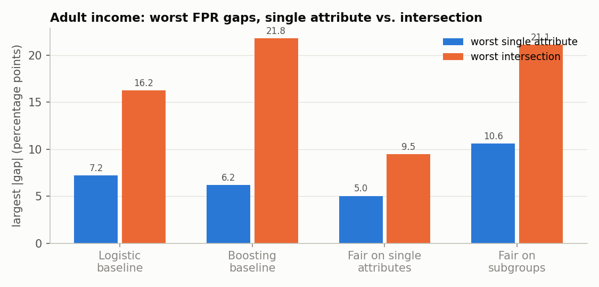
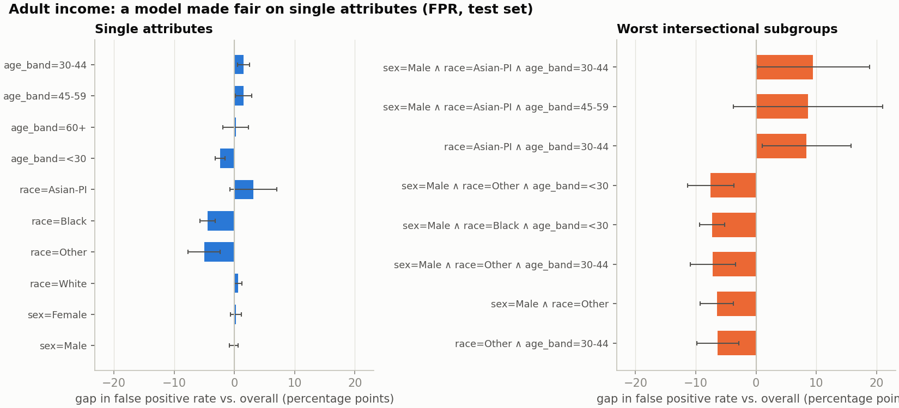
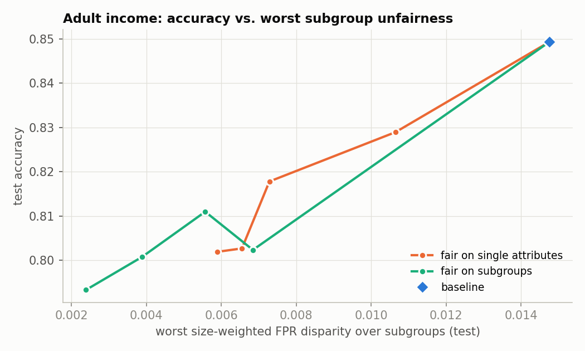
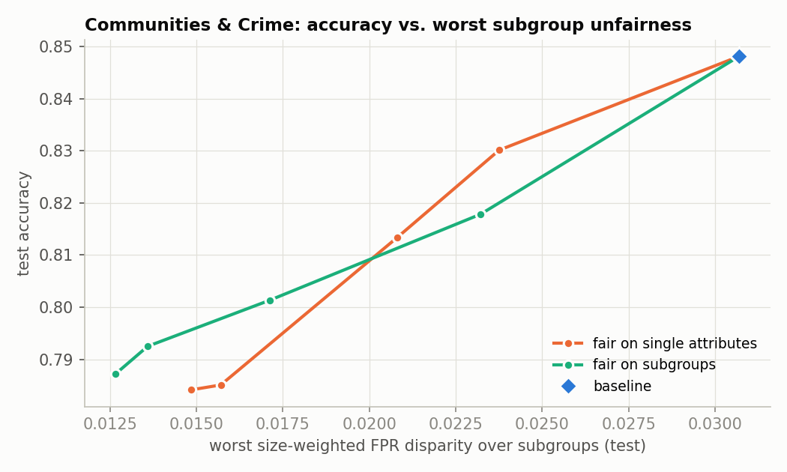
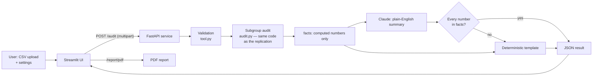

# Hidden Unfairness

**Replicating fairness gerrymandering in social and clinical data, and a tool to audit for it.**

A model can look fair when you check one attribute at a time (equal error rates across sexes, and separately across races) and still treat a specific intersection, such as older White men or young Black patients, very differently. Kearns, Neel, Roth and Wu (2018) called this *fairness gerrymandering*. This repository:

1. **replicates** their finding on the dataset they used (Communities and Crime) and tests whether it holds on two more (UCI Adult, and a hospital readmission dataset);
2. **fixes** it with their fictitious-play algorithm and maps what that costs in accuracy;
3. **packages** the audit as a small product (FastAPI + Streamlit + Docker): upload predictions and get a report of the worst subgroups, with a plain-English summary whose numbers are checked against the computed results.

> Status: research code written in about a day. Every number below comes from `results/*.json`, which `scripts/run_experiments.py` writes, and is measured on held-out test data unless marked *train*.

---

## Contents

- [Key results](#key-results)
- [1. Background](#1-background)
- [2. Question](#2-question)
- [3. Data](#3-data)
- [4. Method](#4-method)
- [5. Results](#5-results)
- [6. Comparison with the paper and its reference code](#6-comparison-with-the-paper-and-its-reference-code)
- [7. The audit tool](#7-the-audit-tool)
- [8. Limitations](#8-limitations)
- [9. What I would do next](#9-what-i-would-do-next)
- [10. Reproduce](#10-reproduce)

---

## Key results

| | Communities & Crime (FPR) | Adult income (FPR) | Diabetes readmission (FNR) |
|---|---|---|---|
| Baseline logistic regression accuracy | 84.8% | 84.9% | 67.8% (balanced 60.9%) |
| Worst single-attribute gap | +12.2 pp (low % White) | +7.2 pp (age 60+) | +28.8 pp (age < 40) |
| Worst intersectional gap | +29.8 pp (low % White ∧ low % Asian ∧ high % 65+; 32 rows) | +16.2 pp (male ∧ White ∧ 60+; 404 rows) | +34.3 pp (Black ∧ age < 40; 33 rows) |
| Intersection ÷ single | 2.5× | 2.2× | 1.2× |
| Subgroup-fair model: accuracy, worst size-weighted gap | 80.1%, 0.0171 (was 0.0307) | 81.1%, 0.0056 (was 0.0148) | 60.4% balanced, 0.00078 (was 0.00274) |

*pp = percentage points. "Gap" = the subgroup's error rate minus the overall rate. The size-weighted gap is the paper's measure of unfairness (defined in §4).*

**In one paragraph:** checking one attribute at a time understates the worst disparity by roughly 2–3.5× on Communities and Adult, for both logistic regression and gradient boosting. On Adult the effect is statistically solid: White men aged 60+ have a false positive rate 16.2 ± 4.1 points above average, over twice the largest single-attribute gap. Subgroup-fair training reduces the paper's size-weighted unfairness by 45–70%, at a cost of 4–5 accuracy points on Communities and Adult and under 1 balanced-accuracy point on Diabetes. Three results are less tidy than the paper's framing suggests:
- **Readmission data:** the problem is mostly a single attribute (age under 40), so intersections add little (1.2×).
- **Small subgroups:** size-weighting lets some small groups get *worse* under the "fair" model.
- **Reference code:** the authors' reference code appears to contain an indexing bug in its cost update ([§6](#6-comparison-with-the-paper-and-its-reference-code)).

---

## 1. Background

> Kearns, M., Neel, S., Roth, A. & Wu, Z. S. (2018). *Preventing Fairness Gerrymandering: Auditing and Learning for Subgroup Fairness.* Proceedings of the 35th International Conference on Machine Learning (ICML), PMLR 80. [arXiv:1711.05144](https://arxiv.org/abs/1711.05144)

Standard fairness checks pick a few groups (e.g. men and women, then each race) and require a statistic such as the false positive rate (FPR) to be roughly equal across them. The paper shows that this can be satisfied while a structured subgroup defined by several attributes at once is treated very differently. Their proposal:

- Require fairness for **every** group in a rich class *G* (e.g. all conjunctions of attributes, or all linear threshold functions of them).
- Score each group by **size-weighted disparity**, so tiny groups don't dominate.
- **Audit:** finding the most-violated group is a learning problem (hard in the worst case, workable with heuristics in practice).
- **Learn:** a two-player game between a Learner and an Auditor, solved by fictitious play, gives a classifier that is fair to all of *G*.

The authors released a reference implementation, [GerryFair](https://github.com/algowatchpenn/GerryFair) (MIT licence).

## 2. Question

1. Does a model that is fair by single attributes hide larger unfairness at intersections, on the paper's dataset and on two others?
2. Does subgroup-fair training remove it, and how much accuracy does that cost?
3. Do my results, and my implementation, agree with the paper and its reference code?

## 3. Data

| Dataset | Rows | Outcome (1 =) | Protected attributes | Audited metric |
|---|---|---|---|---|
| [Communities and Crime](https://archive.ics.uci.edu/dataset/183/communities+and+crime) (UCI), used in the paper | 1,994 communities | in the top 30% for violent crime per capita (583 positives, as in GerryFair) | 18 attributes from GerryFair's `communities_protected.csv` for the paper-setting experiment; 7 median-split demographic shares (race, foreign-born, age 65+, age 12–29) for the enumerated audit | false positive rate |
| [Adult](https://archive.ics.uci.edu/dataset/2/adult) (UCI) | 45,222 people | income > $50K | sex, race (White / Black / Asian-PI / Other), age band (<30, 30–44, 45–59, 60+) | false positive rate |
| [Diabetes 130-US hospitals](https://archive.ics.uci.edu/dataset/296/diabetes+130-us+hospitals+for+years+1999-2008) (UCI; Strack et al., 2014) | 69,970 patients (first encounter each) | readmitted within 30 days (9.0%) | sex, race (6 groups incl. unknown), age band (<40, 40–59, 60–79, 80+) | **false negative rate**: a missed high-risk patient is the costly error |

Why a clinical dataset: bias in clinical risk tools is a documented, high-stakes problem (Obermeyer et al., 2019, *Science*, found racial bias in a widely used care-management algorithm).

Preprocessing notes:
- **Communities & Crime:** missing police statistics are imputed with the median. Rows are *communities*, so "subgroups" are kinds of community, not people.
- **Diabetes:** one encounter per patient, so the same person never appears in both train and test. Patients discharged to hospice or who died are excluded. Positives are weighted 10.2× (the class ratio) so the model actually flags patients.

All experiments use one stratified 70/30 train/test split (seed 0).

## 4. Method

**Metrics.** For a group *g* and a metric (FPR, FNR, …), the **gap** is `rate(g) − rate(all)`. The paper's **size-weighted disparity** is

```
γ(g) = α(g) · |rate(g) − rate(all)|,   α(g) = share of all rows that are in g AND in the metric's base population
```

For FPR the base population is the true negatives; for FNR it is the true positives. I report both the raw gap (with a 95% binomial interval) and the weighted gap. A raw gap is called *reliable* if the group has ≥ 30 base-population rows in the test set.

**Audit** ([`src/subgroup_audit/audit.py`](src/subgroup_audit/audit.py)):
- *Single-attribute check*: every value of every protected attribute.
- *Enumerated subgroup audit*: every conjunction of up to three attribute values (e.g. `sex=Male ∧ race=White ∧ age=60+`), checked exhaustively, which is tens to hundreds of groups.
- *Linear-threshold audit*: the paper's richer class, {x : w·x′ > 0} over the protected attributes. Found as in GerryFair by regressing each base row's error residual on x′.

**Fix: fictitious play** ([`src/subgroup_audit/mitigation.py`](src/subgroup_audit/mitigation.py)). Each round:
1. The *Learner* best-responds to the Auditor's average Lagrange multipliers by solving a cost-sensitive classification problem. I reduce this to weighted classification, so any scikit-learn model works; I used logistic regression and gradient boosting.
2. The *Auditor* best-responds to the Learner's average classifier by returning the group with the largest weighted disparity. If that disparity exceeds γ, the group's multiplier grows (bounded by C = 10).

The output is the uniform mixture of the Learner's classifiers, a randomised classifier, so reported rates are expected rates.

**The gerrymandering experiment.** The same learner is run twice with different auditors:
- **Fair on single attributes**: the auditor only sees order-1 groups. This is a model that passes the standard check.
- **Fair on subgroups**: the auditor sees all conjunctions up to order 3 (or linear thresholds in the paper setting).

Then both are audited on intersections. Sweeping γ ∈ {0.02, 0.01, 0.005, 0.0025, 0.001} traces the trade-off. Headline models use γ = 0.005, or 0.001 for Diabetes: its FNR disparities are weighted by the share of positives (9%), so they are about 10× smaller.

## 5. Results

### 5.1 Single attributes hide intersectional gaps




Across every model on Communities and Adult (both baselines, and both fair models), the worst intersection is 1.9–4.1× the worst single attribute. Gradient boosting shows *more* hidden unfairness than logistic regression: on Adult its worst intersection is Asian/Pacific Islander men aged 45–59, +21.8 ± 14.3 pp.

**Adult, baseline logistic regression** ([full chart](figures/adult_baseline_gaps.png)):
- Single-attribute FPR gaps are all within about 7 points.
- But men × White × 60+ sit 16.2 ± 4.1 points above average (404 true negatives), and men × 60+ sit 14.7 ± 3.8 points above.
- The single-attribute check flags "age 60+" (+7.2 pp) but misses that the effect is concentrated in older White men.

**A model that passes the single-attribute check** (fair on single attributes, γ = 0.005):



Every single-attribute gap is now within ±5 pp, but intersections reach +9.5 pp, and several are significantly below average (e.g. young Black men, −7 pp). By the paper's own measure the largest size-weighted violation (0.0073) now sits at an intersection, above both γ and every single attribute (0.0065). This is fairness gerrymandering as the paper defines it.

**Communities & Crime** ([chart](figures/communities_gerrymandering.png)):
- Same direction: the model that is fair on single attributes still has communities with low % White ∧ low % Asian ∧ high % aged 65+ at +24.9 pp.
- But the test set has only 599 communities, so that group has 32 true negatives and its 95% interval is ±17 pp. Treat C&C intersections as indicative, not conclusive.

**Diabetes readmission** ([chart](figures/diabetes_baseline_gaps.png)): the baseline misses readmissions of patients under 40 far more often than average: FNR +28.8 ± 8.5 pp (97 readmitted patients in the test set). The worst intersection, Black patients under 40, is +34.3 ± 13.2 pp, only 1.2× the single-attribute gap, and with 33 patients its interval overlaps it.
  - **No meaningful gerrymandering here.** The single-attribute check already finds the real problem: the model leans on age, and younger patients' readmissions are under-predicted.
  - **Single-attribute fairness is enough on this dataset.** With γ = 0.001, training for single attributes cuts the worst weighted gap from 0.00274 to 0.00073 and the under-40 gap to +11.1 pp, for 0.5 points of balanced accuracy. Subgroup-fair training performs the same (0.00078).
  - **Why this matters:** it is a useful negative result. Gerrymandering is a risk to test for, not something guaranteed to appear.

### 5.2 Fixing it, and what it costs





| γ = 0.005 (Diabetes: 0.001) | Communities acc. / worst weighted gap | Adult acc. / worst weighted gap | Diabetes bal. acc. / worst weighted gap |
|---|---|---|---|
| Baseline logistic regression | 84.8% / 0.0307 | 84.9% / 0.0148 | 60.9% / 0.00274 |
| Fair on single attributes | 81.3% / 0.0208 | 81.8% / 0.0073 | 60.4% / 0.00073 |
| Fair on subgroups (logistic) | 80.1% / 0.0171 | 81.1% / 0.0056 | 60.4% / 0.00078 |
| Fair on subgroups (boosting) | 80.7% / 0.0187 | 82.3% / 0.0061 | 60.6% / 0.00131 |

- **Accuracy cost.** Subgroup fairness costs about 4–5 accuracy points on Communities and Adult, and half a balanced-accuracy point on Diabetes, where the main disparity is easy to correct.
- **Subgroup-fair is consistently better per unit of accuracy.** At about 80% accuracy on Adult, subgroup-fair training reaches a worst weighted gap of 0.0039 against 0.0066 for single-attribute-fair training.
- **In-sample, the constraint is met.** On Adult the training-set worst weighted gap is 0.0046 ≤ γ.
- **Out-of-sample, it holds only partly.** On test it is 0.0056, and on Communities 0.0171 vs. 0.0044 on train.

**What the weighted measure does not protect.** Because disparities are multiplied by group size, a small group can keep a large raw gap, or even get a larger one, while the weighted constraint is satisfied:
- On Adult, Asian/Pacific Islander men aged 30–44 (67 test negatives) go from +15.3 pp under the baseline to +21.1 pp under the subgroup-fair model.
- This is a property of the paper's definition, not a bug. It is the main reason the audit tool reports raw gaps with intervals next to weighted gaps.

## 6. Comparison with the paper and its reference code

**Paper setting.** Linear-threshold subgroups over the 18 protected attributes GerryFair uses for Communities & Crime, logistic-regression learner:


| γ | train error | train γ-unfairness | test error | test γ-unfairness |
|---|---|---|---|---|
| 0.02 | 13.2% | 0.0140 | 17.7% | 0.0298 |
| 0.01 | 14.0% | 0.0100 | 19.0% | 0.0249 |
| 0.005 | 17.0% | 0.0039 | 22.1% | 0.0199 |
| 0.0025 | 19.8% | 0.0023 | 24.5% | 0.0186 |
| 0.001 | 19.8% | 0.0051 | 24.3% | 0.0147 |

**Where my results agree with the paper:**
1. Unconstrained models are far from subgroup-fair even when single-attribute checks look acceptable (§5.1).
2. Fictitious play drives the auditor's in-sample violation down to about γ within 50 iterations, tracing a smooth error-vs-unfairness curve ([convergence](figures/communities_convergence.png)).
3. Lower γ costs accuracy.

**Where they differ, or add something:**
1. **Generalisation.** On 1,395 training communities the in-sample guarantee only partly carries over. Test unfairness falls from 0.030 to 0.015 while train unfairness falls to 0.002. The paper's guarantees are about the training distribution; the authors' follow-up empirical study (Kearns et al., FAT* 2019, arXiv:1808.08166) looks at generalisation in more depth.
2. **Not universal.** Intersections add little on the readmission data (1.2×), where one attribute (age) carries most of the disparity.
3. **Learner oracle.** GerryFair's learner solves cost-sensitive classification by regressing each cost with linear regression. I reduce it to *weighted* classification, which is equivalent in the limit and lets me plug in gradient boosting. Absolute error levels are therefore not directly comparable to the paper's figures.
4. **I did not reproduce exact figures from the paper.** The comparison above is about shapes and directions. *(Before citing a numeric match, check against the experiment section of the paper.)*

**Possible indexing bug in the reference implementation.** In GerryFair's `Auditor.update_costs` (`gerryfair/auditor.py`, master branch as downloaded on 29 Oct 2026):

```python
for i in range(n):
    X_prime_0_index = 0          # reset on every iteration of the loop...
    if self.y[i] == 0:
        new_group_cost = (1.0/n)*pos_neg*C*(1.0/iteration) * (g_weight - g_members[X_prime_0_index])
        ...
        X_prime_0_index += 1     # ...so this increment never takes effect
```

Because the index is reset inside the loop, every negative example receives the penalty of the *first* negative example, instead of its own group membership. The penalty therefore no longer targets the violating group.

I could not run the original code in my environment. Instead `SubgroupFairClassifier(reference_index_bug=True)` reproduces this exact behaviour inside my implementation. On Communities & Crime (γ = 0.005):

| | train error | train γ-unfairness | test error |
|---|---|---|---|
| correct per-row update | 17.0% | 0.0039 | 22.1% |
| GerryFair's update (ported) | **67.9%** | 0.0019 | 68.0% |

With the bug, the learner collapses to predicting "high crime" for nearly every community. That is trivially "fair" but useless. If confirmed by running GerryFair directly, this would affect any results produced with that version of the package. **Next step: confirm with the original code, then open an issue with the maintainers.**

## 7. The audit tool

Upload a CSV of true outcomes, model predictions and attributes. Pick the protected attributes and a metric. The tool searches all single attributes and their intersections and returns an interactive report and a PDF.




**Keeping the AI summary trustworthy** ([`report.py`](src/subgroup_audit/report.py)):
1. The LLM receives only a small dictionary of already-computed figures (`facts`), never the uploaded rows.
2. The prompt requires numbers copied exactly. Every number in the reply is then extracted and matched against `facts`, and **one unmatched number rejects the whole summary**. The tool then falls back to a deterministic template and says so.
3. The UI and PDF always show the computed figures and the table next to the text, along with a badge saying whether the text came from the LLM or the template.

The model is `claude-opus-5-5` (override with `AUDIT_LLM_MODEL`) with server-side refusal fallback enabled. Without an `ANTHROPIC_API_KEY`, the template is used. *The LLM path is covered by unit tests with a mocked model (accept, reject, failure). It has not yet been exercised against the live API in this repository.*

**Validation against the replication.** `tests/test_validation.py` feeds the tool the replication's own test-set predictions (`examples/*.csv`) and asserts that it returns the same worst single attribute, worst intersection, top-10 weighted subgroups and maximum weighted gap as the replication pipeline. It passes for Adult and Diabetes.

**API**

```bash
curl -F file=@examples/adult_test_predictions.csv -F label_col=label -F pred_col=prediction \
     -F protected_cols=sex,race,age_band -F metric=fpr localhost:8000/audit
```

| Endpoint | Purpose |
|---|---|
| `GET /health` | liveness |
| `POST /audit` | multipart CSV + `label_col`, `pred_col`, `protected_cols`, `metric` (`fpr`/`fnr`/`positive_rate`/`error_rate`), `max_order` (1–3), `min_size`, `use_llm` → JSON |
| `POST /report/pdf` | `{"result": <audit JSON>}` → PDF |

**Validation of inputs.**
- Labels must be binary; predictions may be binary or probabilities.
- At most 5 protected attributes.
- Numeric attributes with many values (e.g. raw age) are binned into quartiles.
- Files are capped at 50 MB and 500,000 rows.
- Clear 422 errors otherwise.

**Run it**

```bash
# Local
pip install -r requirements.txt
uvicorn app.api:app --port 8000 &
API_URL=http://localhost:8000 streamlit run app/streamlit_app.py
# UI only (runs the audit in-process; this is what a single free-tier container uses)
streamlit run app/streamlit_app.py

# Docker: API + UI as two services
docker compose up --build        # UI on :8501, API on :8000
```

**Deploying a free demo.**
- The `Dockerfile` runs the UI as a single container and honours `$PORT`, so it can be deployed as-is to Hugging Face Spaces (Docker SDK) or Render's free tier.
- On Streamlit Community Cloud, point it at `app/streamlit_app.py`.
- Add `ANTHROPIC_API_KEY` as a secret to enable AI summaries.

*(Live demo link: TODO after deployment.)*

**Engineering.**
- 25 unit, API and validation tests (`pytest`).
- The metric tests include a hand-built "XOR" dataset where every single attribute has exactly the same FPR but every intersection is off by 15 points.
- GitHub Actions runs the tests, builds the Docker image and smoke-tests the API inside it.

## 8. Limitations

- **One split, one seed.** No confidence intervals on the trade-off curves; Communities & Crime in particular would benefit from repeated splits.
- **Small groups are noisy.** C&C intersections have 30–50 test negatives (intervals around ±15 pp). The audit reports intervals, but the "worst subgroup" list is still a multiple-comparisons search. Some extreme gaps will be noise.
- **Communities are not people.** On C&C, "subgroups" are kinds of community defined by demographic shares. I binarised them at the median for the enumerated audit, which is a modelling choice.
- **Size-weighting is a value judgement.** It deliberately tolerates large disparities in small groups (§5.2).
- **The fair classifier is randomised.** Two people with identical features can receive different predictions. This is standard in this literature but may be unacceptable in some deployments.
- **The reference-code finding uses a port,** not the original package (§6).
- **Diabetes labels and attributes** come from hospital records. "Race" and readmission are recorded imperfectly, and FNR parity is one of several defensible clinical fairness criteria.
- **The tool audits; it doesn't explain.** A gap is evidence to investigate, not proof of discrimination.

## 9. What I would do next

1. Run GerryFair directly to confirm the indexing issue, and report it to the maintainers.
2. Repeat every experiment over 10 random splits and report intervals on the trade-off curves.
3. Add the paper's richer auditor class to the tool, and a multiple-testing correction (e.g. Benjamini–Hochberg) on raw-gap flags.
4. Compare with other intersectional methods (multicalibration; Hébert-Johnson et al., 2018).
5. Test the LLM summary against the live API, with an evaluation of faithfulness and readability on many audits.

## 10. Reproduce

```bash
python3 -m venv .venv && source .venv/bin/activate
pip install -r requirements-dev.txt
bash scripts/download_data.sh          # ~25 MB from the UCI repository
python scripts/run_experiments.py      # ~10 min on a laptop; writes results/ and figures/
python scripts/make_examples.py        # example prediction files for the tool
python scripts/build_notebook.py       # executes notebooks/replication.ipynb
pytest -q
```

```
src/subgroup_audit/   data.py · metrics.py · audit.py · mitigation.py · experiments.py · report.py · tool.py · plots.py
app/                  api.py (FastAPI) · streamlit_app.py
scripts/              download_data.sh · run_experiments.py · make_examples.py · build_notebook.py
notebooks/            replication.ipynb
results/ figures/     generated outputs
tests/                unit, API and replication-validation tests
```

## References

- Kearns, M., Neel, S., Roth, A., Wu, Z. S. (2018). Preventing Fairness Gerrymandering: Auditing and Learning for Subgroup Fairness. *ICML*. arXiv:1711.05144.
- Kearns, M., Neel, S., Roth, A., Wu, Z. S. (2019). An Empirical Study of Rich Subgroup Fairness for Machine Learning. *FAT\**. arXiv:1808.08166.
- GerryFair reference implementation: https://github.com/algowatchpenn/GerryFair (MIT).
- Obermeyer, Z., Powers, B., Vogeli, C., Mullainathan, S. (2019). Dissecting racial bias in an algorithm used to manage the health of populations. *Science* 366(6464).
- Strack, B. et al. (2014). Impact of HbA1c Measurement on Hospital Readmission Rates. *BioMed Research International*.
- Hébert-Johnson, Ú., Kim, M., Reingold, O., Rothblum, G. (2018). Multicalibration. *ICML*.

## Licence

MIT. Datasets are from the UCI Machine Learning Repository under their respective terms.
