# Hidden Unfairness in Clinical Risk Models

**Replicating fairness gerrymandering (Kearns et al., 2018) and auditing which patients clinical risk scores miss.**

A risk model can look fair when you check one attribute at a time (equal miss rates across sexes, and separately across races) and still under-serve a specific combination of them, such as young Hispanic women or older White men. Kearns, Neel, Roth and Wu (2018) called this *fairness gerrymandering*. Clinical prediction is where it matters most: care-management programmes, readmission prevention and triage all enrol patients by risk score, and a hidden subgroup that the score under-rates simply never gets the care.

This repository:

1. **replicates** the paper's finding on its own dataset (Communities and Crime) as a check that the method and code are right;
2. **applies** it to two public clinical datasets: 30-day hospital readmission (Diabetes 130-US) and high healthcare utilisation (MEPS, the setting of Obermeyer et al., 2019). It audits risk scores the way they are actually used: flag the top 20%, then ask who is missed, whether scores are calibrated for every subgroup, and whether patients with the same score are equally sick;
3. **fixes** subgroup unfairness with the paper's fictitious-play algorithm and measures what that costs;
4. **packages** the audit as a tool (FastAPI + React + Docker). A clinical or quality team uploads de-identified predictions and gets a report on the worst subgroups, with a plain-English summary whose every number is checked against the computed results.

> Status: research code. Every number below comes from `results/*.json`, which `scripts/run_experiments.py` writes, and is measured on held-out test patients unless marked *train*. Nothing here is a validated clinical tool.

---

## Contents

- [Key results](#key-results)
- [1. Background](#1-background)
- [2. Questions](#2-questions)
- [3. Data](#3-data)
- [4. Method](#4-method)
- [5. Clinical results](#5-clinical-results)
- [6. Replicating the paper](#6-replicating-the-paper)
- [7. The audit tool](#7-the-audit-tool)
- [8. Evaluation](#8-evaluation)
- [9. Limitations](#9-limitations)
- [10. What I would do next](#10-what-i-would-do-next)
- [11. Reproduce](#11-reproduce)
- [Appendix: Adult income](#appendix-adult-income)

---

## Key results

**Clinical risk scores, audited as used (top 20% of patients flagged).** Both models are race-blind: race is used only to audit.

| | MEPS: high utilisation (7,674 test adults) | Diabetes: 30-day readmission (20,991 test patients) |
|---|---|---|
| Who is missed most (FNR vs. average) | adults 18–29: **+43.8 ± 5.5 pp**; Hispanic 18–29: +53.7 ± 4.6 pp | patients under 40: **+24.1 ± 6.3 pp**; Black patients under 40: +26.4 ± 9.8 pp |
| Worst calibration gap, single attribute | Asian patients: risk over-stated by 3.8 ± 2.4 pp | none above 2.8 pp (race unknown, ± 1.8): well calibrated |
| Worst calibration gap, intersection | White men 65+: risk **under-stated by 11.8 ± 5.1 pp** (3.1× the single-attribute gap) | Hispanic patients 80+: −10.4 ± 12.9 pp (36 patients; within noise) |
| High-need patients (≥ 3 chronic conditions) flagged | White 70%, Black **61%**, Hispanic **56%** | (no need measure) |

**In one paragraph:**
- **Who gets missed.** At realistic programme capacity both clinical scores miss young patients far more than older ones, and that is visible from age alone.
- **Hidden at intersections.** The disparities that single attributes *hide* show up in **calibration** and in **measured need**. On MEPS the worst intersectional calibration gap is 3.1× the worst single-attribute one, and judged against chronic illness rather than the utilisation proxy, the worst missed subgroup is 2.0× the worst single attribute.
- **Race and need.** Among adults with three or more chronic conditions, the utilisation model flags 70% of White patients but 61% of Black and 56% of Hispanic patients, echoing the proxy-label bias Obermeyer et al. found.
- **The fix.** Fair training (§5.4) removes about two-thirds of the measured FNR disparity for 0.5–2.6 points of balanced accuracy. Equalising single attributes is already enough on these clinical datasets, because the dominant disparity is age.
- **The replication works.** On the paper's own dataset the gerrymandering effect is clear (2.5–3.5×). My implementation tracks the paper, and the authors' reference code appears to contain an indexing bug ([§6](#6-replicating-the-paper)).
- **The tool is evaluated, not just tested** ([§8](#8-evaluation)).
  - On simulated data with known planted bias, it finds gerrymandered unfairness 92–100% of the time, while one-attribute-at-a-time checks catch it 4% of the time.
  - With its multiple-comparisons correction, it raises a false alarm on fair data 2–6% of the time, against 72–76% uncorrected.
  - Its AI-summary checker catches 100% of numbers attached to the wrong group.

---

## 1. Background

> Kearns, M., Neel, S., Roth, A. & Wu, Z. S. (2018). *Preventing Fairness Gerrymandering: Auditing and Learning for Subgroup Fairness.* ICML, PMLR 80. [arXiv:1711.05144](https://arxiv.org/abs/1711.05144)

**Subgroup fairness.**
- Standard checks require a statistic, such as the false negative rate (FNR), to be roughly equal across a few pre-chosen groups.
- The paper shows this can hold while a group defined by *several* attributes is treated very differently.
- It proposes requiring fairness for **every** group in a rich class (all conjunctions of attributes, or all linear threshold functions of them), with each group's disparity **weighted by its size**.
- It gives an algorithm that trains a model meeting that requirement: a game between a Learner and an Auditor, solved by fictitious play.
- The authors released a reference implementation, [GerryFair](https://github.com/algowatchpenn/GerryFair) (MIT).

**Why healthcare.**
- **Proxy labels.** Obermeyer et al. (2019, *Science*) showed that a widely used care-management algorithm, trained to predict *cost*, assigned Black patients the same risk score as White patients who were less sick. Cost is a proxy for need, and less is spent on Black patients with the same illness.
- **Capacity.** Clinical scores are used with a fixed capacity: a programme enrols the top few percent.
- **Calibration.** Clinicians read a score as "this patient's risk", so calibration matters as much as error rates.

This project asks whether the subgroup lens of Kearns et al. finds problems that a standard clinical fairness check would miss.

## 2. Questions

1. **Replication:** on the paper's dataset, does a model that is fair by single attributes hide larger unfairness at intersections, and does fictitious play fix it?
2. **Clinical audit:** when clinical risk scores are used as in practice (top 20% flagged), which patient subgroups are missed, mis-calibrated, or under-served relative to their actual illness? Do single-attribute checks find them?
3. **Mitigation:** what does subgroup-fair training cost in accuracy on clinical data?

## 3. Data

| Dataset | Patients / rows | Outcome (1 =) | Protected attributes | Role |
|---|---|---|---|---|
| [MEPS 2015](https://meps.ahrq.gov/mepsweb/data_stats/download_data_files_detail.jsp?cboPufNumber=HC-181) (AHRQ, file HC-181) | 25,577 adults | 10+ visits/nights of care in the year (21%) | sex, race/ethnicity (White, Black, Hispanic, Asian, Other), age band | clinical, main |
| [Diabetes 130-US hospitals](https://archive.ics.uci.edu/dataset/296/diabetes+130-us+hospitals+for+years+1999-2008) (UCI; Strack et al., 2014) | 69,970 patients | readmitted within 30 days (9.0%) | sex, race (6 groups incl. unknown), age band | clinical |
| [Communities and Crime](https://archive.ics.uci.edu/dataset/183/communities+and+crime) (UCI) | 1,994 communities | top 30% for violent crime (as in GerryFair) | GerryFair's 18 protected attributes; 7 median-split demographic shares for the enumerated audit | replication anchor (the paper's dataset) |
| [Adult](https://archive.ics.uci.edu/dataset/2/adult) (UCI) | 45,222 people | income > $50K | sex, race, age band | [appendix](#appendix-adult-income) |

Clinical modelling choices:
- **Race-blind models.** Race is never a model input, as for many deployed clinical scores; it is used only to audit.
- **One encounter per patient (Diabetes).** Only each patient's first encounter is kept, so no patient is in both train and test. Patients discharged to hospice or who died are excluded.
- **MEPS label and need measure.** The label follows AIF360's MEPS benchmark (office + outpatient + ER visits + inpatient nights + home health ≥ 10). Need is measured independently as the number of 13 diagnosed chronic conditions (hypertension, heart disease, diabetes, COPD, cancer, arthritis, asthma, …). Survey weights are not used, so rates describe the sample, not the US population.
- **Positive weighting.** Positives are up-weighted by the class ratio for the 0/1 classifiers, so rare outcomes are actually flagged. Risk scores come from an unweighted logistic regression, so they are calibrated overall.
- **Split.** One stratified 70/30 train/test split (seed 0).

## 4. Method

**Measures.** For a group *g*, the **gap** is `rate(g) − rate(all)`, reported with a 95% interval. The paper's **size-weighted disparity** is

```
γ(g) = α(g) · |rate(g) − rate(all)|,    α(g) = share of all patients that are in g AND in the metric's base population
```

| Metric | Base population | Clinical meaning |
|---|---|---|
| False negative rate (FNR) | patients who had the outcome | **missed** patients |
| False positive rate | patients who did not | false alarms |
| Calibration gap | everyone | mean predicted risk − observed rate; < 0 = risk **under-stated** for that group |

A gap is *reliable* if the group has ≥ 30 patients in the base population.

**Three clinical audits of the same risk score** ([`experiments.py`](src/subgroup_audit/experiments.py)):
1. **Capacity:** flag the top 20% of test patients by risk score (a typical care-management capacity), then compute FNR by subgroup.
2. **Calibration:** calibration gap of the raw scores by subgroup.
3. **Need (MEPS):**
   - Audit the same flags against an *independent* label: ≥ 3 chronic conditions.
   - Compare mean chronic conditions across races within each risk-score decile, the analysis behind Obermeyer et al.'s main figure.

**Search** ([`audit.py`](src/subgroup_audit/audit.py)):
- Every value of each protected attribute (the *single-attribute check*).
- Every conjunction of up to three values (e.g. `sex=Female ∧ race=Hispanic ∧ age=18–29`).
- The paper's linear-threshold class, used in the replication.

**Fix: fictitious play** ([`mitigation.py`](src/subgroup_audit/mitigation.py)).
- **Learner:** best-responds to the Auditor's average Lagrange multipliers by cost-sensitive classification, reduced here to weighted classification so logistic regression or gradient boosting can be used. False negatives cost `positive_cost` times more than false positives.
- **Auditor:** returns the subgroup with the largest weighted disparity. If it exceeds γ, that subgroup's multiplier grows (bounded by C = 10).
- **Output:** the uniform mixture of the Learner's models.
- **Gerrymandering test:** the same learner with an auditor that sees only single attributes gives "fair on single attributes"; with conjunctions, "fair on subgroups".
- **γ by dataset:** MEPS 0.002, Diabetes 0.001, Communities 0.005. FNR disparities are weighted by the share of positives, so they are smaller on rare outcomes.

## 5. Clinical results

### 5.1 Who a care-management programme misses

Flagging the top 20% of patients by risk, then looking at FNR (share of patients who had the outcome but were not flagged):

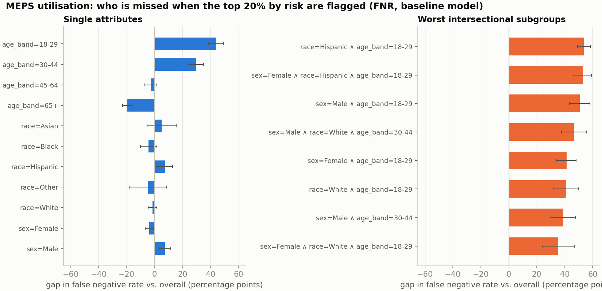

**MEPS (overall FNR 43.9%):**
- Age dominates. Adults 18–29 who become high users are missed 43.8 ± 5.5 pp more often than average, and 30–44 year-olds 29.8 ± 5.2 pp more, while patients 65+ are missed 19.5 pp *less*.
- A plausible reason, not tested here: young patients who become high users have fewer recorded diagnoses for the score to draw on.
- Race on its own shows small, non-significant gaps (Hispanic +7.3 ± 5.6, Black −4.3 ± 5.9).
- Hispanic adults 18–29 are missed most of all (+53.7 ± 4.6 pp).

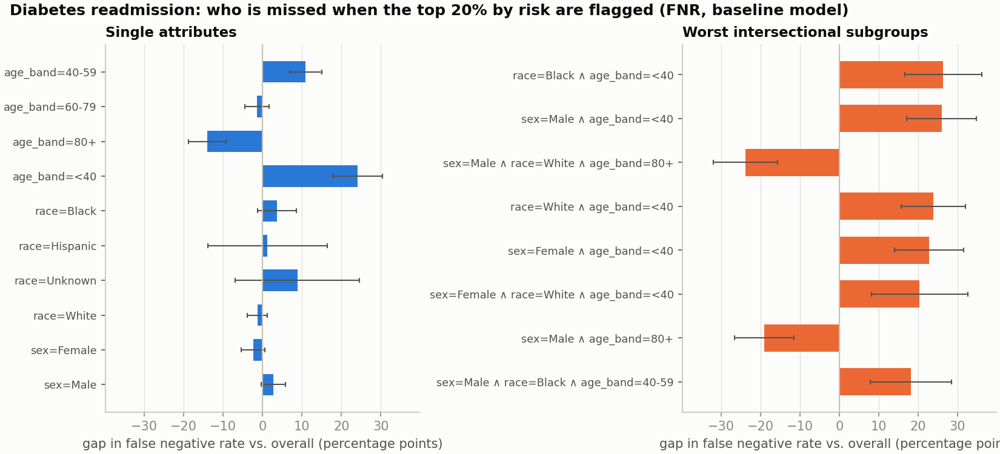

**Diabetes readmission (overall FNR 64.5%):** readmission is hard to predict, and flagging the top 20% catches only about a third of readmissions. Patients under 40 are missed 24.1 ± 6.3 pp more often than average, those over 80 14.0 ± 4.8 pp *less*. Race on its own shows no significant gap (Black +3.7 ± 4.9 pp).

**Single attributes vs. intersections here:** the worst intersection is only 1.2× (MEPS) and 1.1× (Diabetes) the worst single attribute. On missed patients, a standard by-age check would already find the main problem.

### 5.2 Calibration: where intersections hide the problem

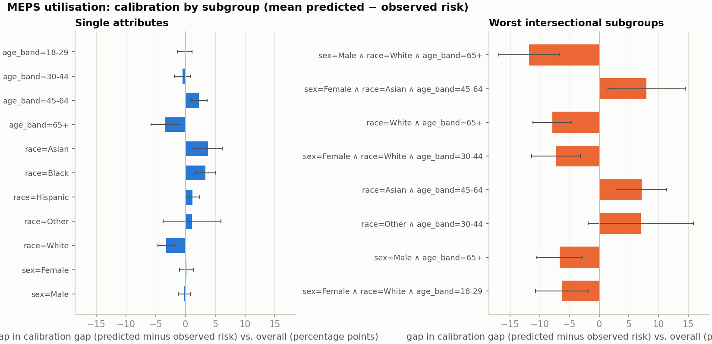

A calibration gap below zero means the model **under-states** that group's risk compared with everyone else.

- **Single attributes look acceptable.** On MEPS no single attribute is off by more than 3.8 pp: Asian +3.8 ± 2.4, Black +3.4 ± 1.7, White −3.2 ± 1.4, age 65+ −3.4 ± 2.4.
- **Intersections are not.** For **White men aged 65+** (323 patients) the model under-states the chance of high utilisation by **11.8 ± 5.1 pp**, 3.1× the worst single-attribute gap. Women 45–64 of Asian ethnicity are over-stated by 8.0 ± 6.5 pp.
- This is fairness gerrymandering in the quantity clinicians actually read off a risk score.
- **Why it matters for the Obermeyer question.** The race-blind model *over*-predicts utilisation for Black patients overall (+3.4 pp). Given their recorded diagnoses, Black patients use less care than the model expects. That is the same mechanism behind proxy-label bias: lower utilisation at equal illness.

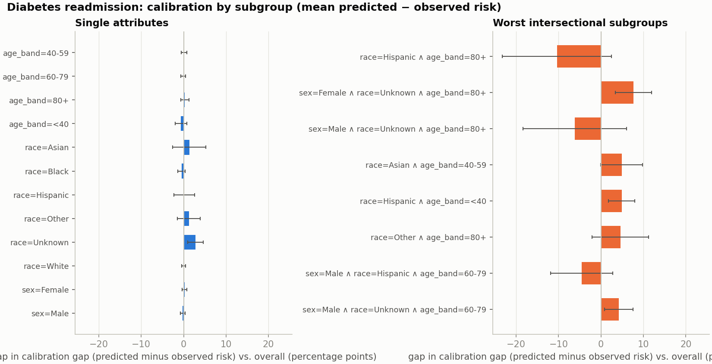

**Diabetes:** single attributes are well calibrated (all within 2.8 pp). Intersections show larger deviations, the worst being Hispanic patients over 80 at −10.4 ± 12.9 pp, but with 36 patients most are within noise. The clearest is women of unknown race aged 80+, whose risk is over-stated by 7.7 ± 4.2 pp (67 patients). Here calibration largely holds at the subgroup level, a useful contrast with MEPS.

### 5.3 Utilisation is a proxy for need

The MEPS model predicts *utilisation*, but a care-management programme exists for patients with high *need*. Auditing the same top-20% flags against an independent need label (≥ 3 chronic conditions):

| | White | Black | Hispanic |
|---|---|---|---|
| High-need patients in test set | 916 | 380 | 318 |
| Share of them flagged | 70% | **61%** | **56%** |
| Mean chronic conditions among flagged | 3.92 | 3.97 | 3.50 |

- **Race gap.** Black high-need patients are 9 points less likely to be flagged than White high-need patients (≈ 3 standard errors), and Hispanic high-need patients 14 points less. Part of this may reflect age differences between the groups, which this table does not adjust for.
- **Intersections.** Against need, the worst missed subgroup (White men 30–44, +55.1 ± 10.4 pp, 31 patients) is 2.0× the worst single attribute (age 30–44, +27.4 ± 8.0). Intersections matter more once the label reflects need rather than use.

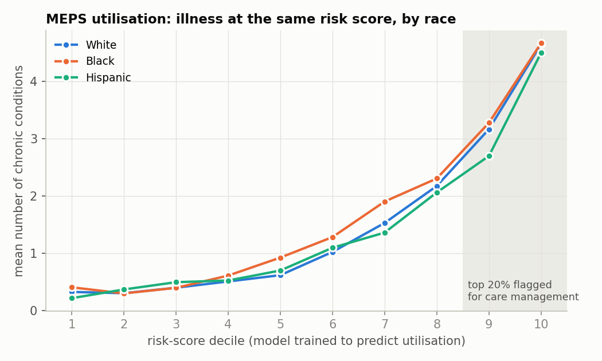

**Obermeyer-style check.**
- In the middle risk deciles (5–7), Black patients carry 0.26–0.37 more chronic conditions than White patients with the same score, the direction Obermeyer et al. reported.
- In the top two deciles, where the programme actually enrols, the curves meet (decile 10: 4.66 vs. 4.64).
- This model sees diagnoses directly, unlike a model trained on past cost, so the proxy bias is weaker at the very top. It shows up instead as fewer Black and Hispanic patients reaching the top 20% at all (flagged: White 27%, Black 20%, Hispanic 12%).
- Per-decile means for Black and Hispanic patients rest on about 150 and 220 patients on average, so treat single-decile differences as indicative.

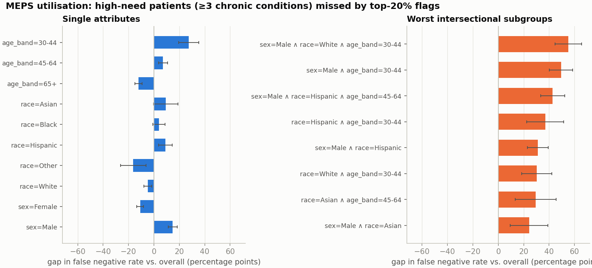

### 5.4 Fixing it, and what it costs

| Model (0/1 classifier) | MEPS: balanced acc. / worst weighted FNR gap | Diabetes: balanced acc. / worst weighted FNR gap |
|---|---|---|
| Baseline logistic regression | 76.0% / 0.0158 | 60.9% / 0.0027 |
| Fair on single attributes | 73.3% / 0.0052 | 60.2% / 0.0010 |
| Fair on subgroups (logistic) | 73.4% / 0.0052 | 60.4% / 0.0009 |
| Fair on subgroups (boosting) | 73.6% / 0.0044 | 60.6% / 0.0010 |

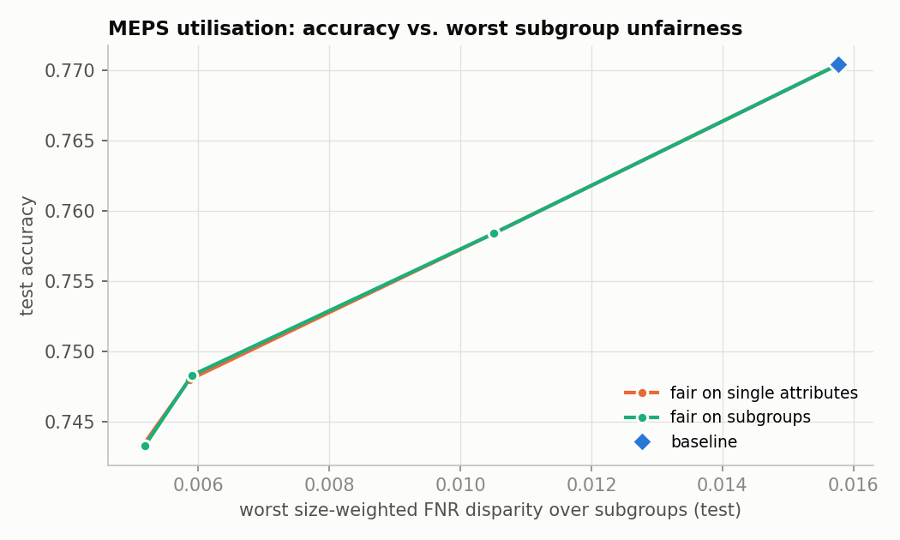
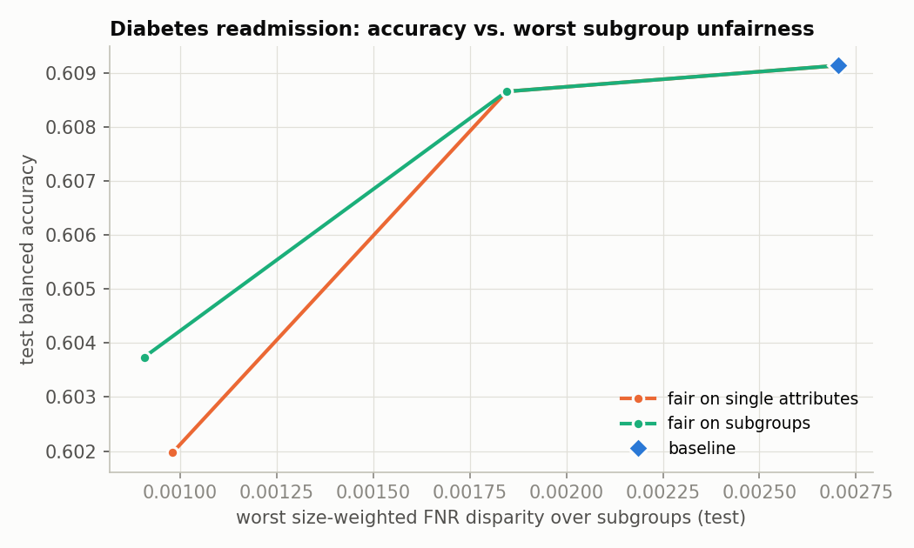

- **Effect.** Fair training cuts the worst size-weighted FNR disparity by about two-thirds on both clinical datasets: on MEPS for 2.6 points of balanced accuracy (the 18–29 miss-rate gap falls from +46.7 to +20.4 pp), and on Diabetes for 0.5 points (the under-40 gap falls from +28.8 to +9.2 pp).
- **Single-attribute fairness is enough here.** Training for single attributes and training for subgroups give the same result on both clinical datasets: the dominant disparity is age, a single attribute, so fixing it fixes most intersections too.
- **The constraint is only approximately met.** On MEPS the trade-off flattens below γ = 0.0025: in-sample violations stay near 0.004 after 50 iterations, short of γ = 0.002.

## 6. Replicating the paper

On **Communities & Crime**, the paper's dataset, the gerrymandering effect replicates clearly:

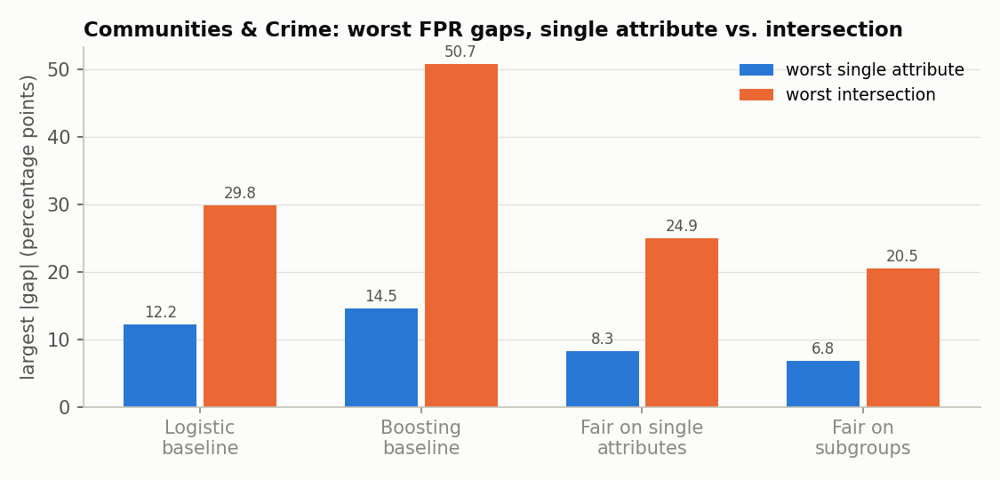

| Model (test, FPR) | Accuracy | Worst single gap | Worst intersection | Ratio | Worst weighted gap |
|---|---|---|---|---|---|
| Logistic baseline | 84.8% | +12.2 pp (low % White) | +29.8 pp | 2.5× | 0.0307 |
| Boosting baseline | 86.3% | +14.5 pp | +50.7 pp | 3.5× | 0.0366 |
| Fair on single attributes | 81.3% | +8.3 pp | +24.9 pp | 3.0× | 0.0208 |
| Fair on subgroups | 80.1% | +6.8 pp | +20.5 pp | 3.0× | 0.0171 |

The worst intersection (low % White ∧ low % Asian ∧ high % aged 65+) has only 32 test negatives (95% interval ±17 pp), so treat it as indicative.

**Paper setting.** Linear-threshold subgroups over the 18 protected attributes GerryFair uses for this dataset:

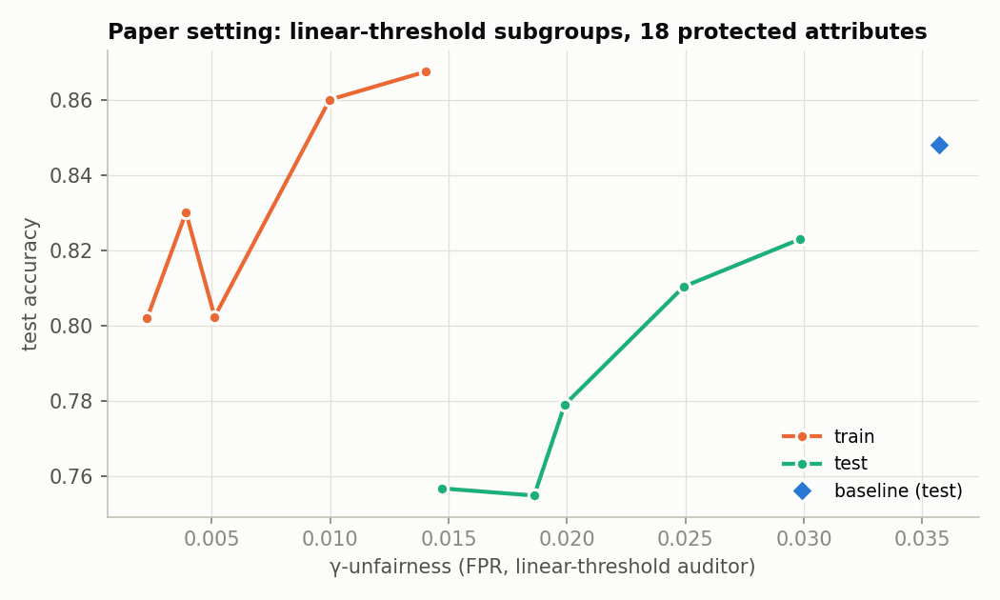

| γ | train error | train γ-unfairness | test error | test γ-unfairness |
|---|---|---|---|---|
| 0.02 | 13.2% | 0.0140 | 17.7% | 0.0298 |
| 0.01 | 14.0% | 0.0100 | 19.0% | 0.0249 |
| 0.005 | 17.0% | 0.0039 | 22.1% | 0.0199 |
| 0.0025 | 19.8% | 0.0023 | 24.5% | 0.0186 |
| 0.001 | 19.8% | 0.0051 | 24.3% | 0.0147 |

**Where my results agree with the paper:**
1. Unconstrained models are far from subgroup-fair.
2. Fictitious play drives the in-sample violation down to about γ ([convergence](figures/communities_convergence.png)).
3. Lower γ costs accuracy.

**Where they differ:**
1. **Generalisation.** With 1,395 training communities the in-sample guarantee only partly carries over (test unfairness 0.030 → 0.015 vs. train 0.014 → 0.002). The authors' follow-up study (Kearns et al., FAT* 2019) examines this.
2. **Not universal.** Gerrymandering in miss rates is weak on the clinical data (§5.1), where one attribute dominates. It is strong in calibration and against measured need (§5.2–5.3).
3. **Learner oracle.** I use weighted classification instead of GerryFair's linear-regression cost oracle, so absolute error levels are not directly comparable to the paper's figures.
4. **Shapes, not figures.** I compare shapes and directions, not exact numbers. *(Before citing a numeric match, check against the paper's experiment section.)*

**Possible indexing bug in the reference implementation.** In GerryFair's `Auditor.update_costs` (`gerryfair/auditor.py`, master branch as downloaded on 29 Oct 2026):

```python
for i in range(n):
    X_prime_0_index = 0          # reset on every iteration of the loop...
    if self.y[i] == 0:
        new_group_cost = (1.0/n)*pos_neg*C*(1.0/iteration) * (g_weight - g_members[X_prime_0_index])
        ...
        X_prime_0_index += 1     # ...so this increment never takes effect
```

Every negative example receives the penalty of the *first* negative example, so the penalty no longer targets the violating group. I could not run the original package in my environment, so `SubgroupFairClassifier(reference_index_bug=True)` reproduces this behaviour in my code. On Communities & Crime (γ = 0.005), training error rises from 17.0% to **67.9%**: the learner collapses to flagging nearly every community, which is trivially "fair" but useless. **This needs confirming with the original code before reporting it to the maintainers.**

## 7. The audit tool

For a clinical quality, equity or data-science team:
1. Upload de-identified, patient-level predictions or risk scores.
2. Set the programme capacity (flag the top X%).
3. Choose what to measure: missed patients, false alarms or calibration.

The tool searches single attributes and every combination of up to three, and returns a report you can read on screen or download as a PDF.

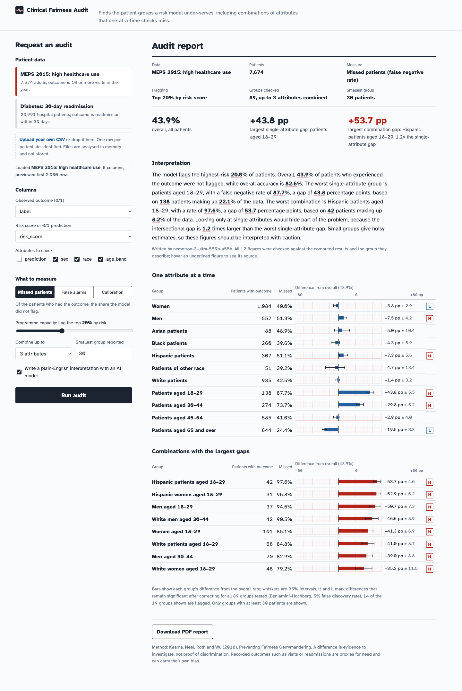

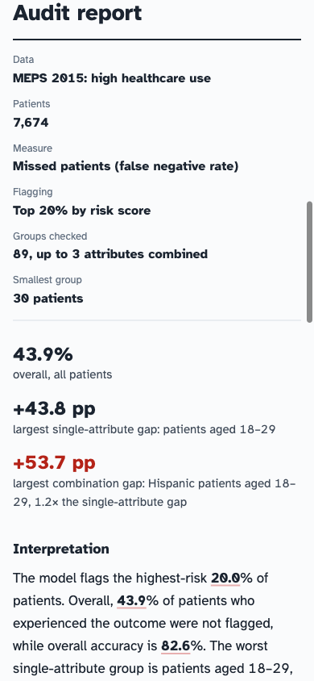

**Design.** The web app (React + TypeScript, in [`frontend/`](frontend/)) borrows the vocabulary of a lab report rather than a dashboard:
- **Request and report.** A requisition on the left, the report on the right.
- **Result rows.** Each group is a result row with its rate, its difference from the overall rate drawn on an ECG-paper strip with a 95% interval, and an **H** / **L** flag only when the difference survives correction for multiple comparisons.
- **Typeface.** Atkinson Hyperlegible, designed by the Braille Institute for low-vision readers, self-hosted so no third-party requests are made.
- **Responsive.** It works down to phone width, with visible keyboard focus and reduced motion respected.

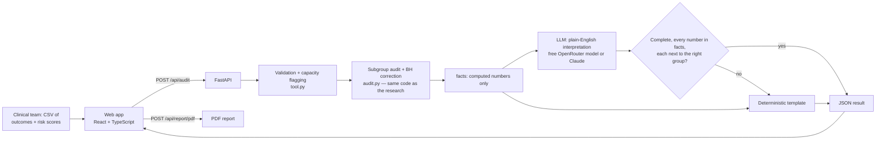

**Keeping the AI interpretation trustworthy** ([`report.py`](src/subgroup_audit/report.py)):
1. **Computed figures only.** The LLM receives a small dictionary of already-computed figures, never patient rows.
2. **Every number is checked.** Each number in its reply is matched against those figures, and must appear in the same or previous sentence as the group it belongs to. "53.7 points for *Black* patients" is rejected when 53.7 is the Hispanic group's figure. Truncated replies are rejected too.
3. **Any failure falls back.** One failure and a deterministic template is shown instead, with a note saying why.
4. **Figures are visible in the text.** Checked figures are underlined; hovering shows which result each came from.

**Which model.**
- **Default:** with `OPENROUTER_API_KEY` set (e.g. in a git-ignored `.env`), the tool uses **free** OpenRouter models: NVIDIA Nemotron 3 Ultra, falling back to Gemma 4 when a free provider is rate-limited. Any model without the `:free` suffix is refused unless `ALLOW_PAID_MODELS=1`.
- **Alternative:** with `ANTHROPIC_API_KEY`, it uses `claude-opus-5-5`.
- **No key:** the template is used.
- **Speed:** free models take 20–60 s, so the interpretation can be switched off for an instant report.

**Validation against the research code.** `tests/test_validation.py` feeds the tool the research pipeline's own test-set outputs (`examples/meps_*.csv`, `examples/diabetes_*.csv`). It checks that the tool finds the same worst single attribute, worst intersection, top-10 weighted subgroups and maximum weighted gap in three modes:
- 0/1 predictions;
- risk scores flagged at 20% capacity;
- calibration.

**API**

```bash
curl -F file=@examples/meps_test_predictions.csv -F label_col=label -F pred_col=risk_score \
     -F protected_cols=sex,race,age_band -F metric=fnr -F flag_top_pct=20 localhost:8000/api/audit
```

| Endpoint | Purpose |
|---|---|
| `GET /api/health` | liveness |
| `GET /api/examples`, `GET /api/examples/{id}.csv` | the two built-in clinical examples |
| `POST /api/audit` | multipart CSV + `label_col`, `pred_col`, `protected_cols`, `metric` (`fnr`/`fpr`/`calibration`/`positive_rate`/`error_rate`), `flag_top_pct` (optional capacity), `max_order` (1–3), `min_size`, `use_llm` → JSON |
| `POST /api/report/pdf` | `{"result": <audit JSON>}` → PDF |
| `GET /` | the web app (built files from `frontend/dist`) |

Every subgroup in the JSON carries its gap, 95% interval, p-value, Benjamini–Hochberg q-value and a `significant` flag.

**Input rules.** Clear 422 errors are returned for problems:
- Outcomes must be binary; predictions may be 0/1 or risk scores.
- At most 5 protected attributes.
- Numeric attributes with many values (e.g. raw age) are binned into quartiles.
- Files are capped at 50 MB and 500,000 rows. Files are processed in memory and not stored.

**Run it**

```bash
# Development: API on :8000, web app with hot reload on :5173 (proxies /api to the API)
pip install -r requirements.txt
uvicorn app.api:app --port 8000 &
cd frontend && npm install && npm run dev

# Production-style: build once, then FastAPI serves the app and the API together on :8000
cd frontend && npm run build && cd .. && uvicorn app.api:app --port 8000

# Docker (multi-stage: builds the web app, then one Python container serves everything)
docker compose up --build        # http://localhost:8000
```

**Deploying.**
- The image honours `$PORT`, so it deploys as-is to Render's free tier or Hugging Face Spaces (Docker SDK).
- Add `OPENROUTER_API_KEY` as a secret for AI interpretations.
- Only upload de-identified data to any hosted demo.

*(Live demo link: TODO after deployment.)*

**Engineering.**
- Python tests (`pytest`): unit, API, validation and LLM-safety tests. They include a hand-built dataset where every single attribute has exactly equal FPR but every intersection is off by 15 points, a truncated-reply test, and a paid-model refusal test.
- GitHub Actions runs the Python tests, type-checks and builds the web app, builds the Docker image, and smoke-tests the API and web app inside it.

## 8. Evaluation

Three evaluations, all re-runnable from [`evals/`](evals/). The first two need no API key.

### 8.1 Does the audit find bias that is really there? ([`evals/audit_detection.py`](evals/audit_detection.py))

The setup:
- **Simulation.** Simulated patient populations (sex × race × age, realistic group sizes) with a miss-rate increase of known size planted in a known subgroup; 50 simulations per setting.
- **Detected** means the planted group is reported as significant after Benjamini–Hochberg correction.

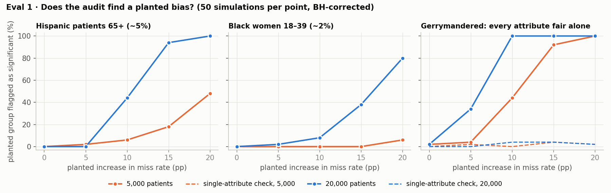

| Planted bias | 5,000 patients | 20,000 patients |
|---|---|---|
| None (false alarm: anything flagged, **with** correction) | 6% | 2% |
| None (false alarm: anything with p < 0.05, **without** correction) | 72% | 76% |
| +15 pp in Hispanic patients 65+ (~5% of patients) | 18% | 94% |
| +20 pp in Black women 18–39 (~2% of patients) | 6% | 80% |
| Gerrymandered ±15 pp, every single attribute exactly fair | 92% | 100% |
| ↳ found by a one-attribute-at-a-time check | 4% | 4% |

**What this shows:**
1. **Correction matters.** Without it, three in four audits of a perfectly fair model would report something "significant", which is why the tool flags only BH-corrected differences.
2. **Single-attribute checks are blind to gerrymandering.** The audit finds a gerrymandered bias almost every time; a single-attribute check is at chance level.
3. **Small groups need data.** A 20-point bias in a group of 2% of patients is usually missed with 5,000 patients and usually found with 20,000. The audit's power, not just its correctness, depends on sample size, and the report says so.
4. **Size-weighting hides small groups.** Under the paper's size-weighted ranking the planted group came top in at most 56% of runs, and under 10% for the 2% group.

### 8.2 Does the summary checker catch an LLM's mistakes? ([`evals/verifier_robustness.py`](evals/verifier_robustness.py))

Correct summaries of 28 real audits (MEPS and Diabetes, 7 settings, 2 search depths) with one injected error each:

| Injected error | Numbers-only check (v1) | Numbers + group check (current) | Cases |
|---|---|---|---|
| None (should pass) | 0% rejected | 0% rejected | 28 |
| A number changed (±0.1 to ±5) | 96% | 98% | 84 |
| A number rounded (43.8 → 44) | 92% | 95% | 84 |
| An invented statistic added | 100% | 100% | 28 |
| Right number, **wrong group** | **0%** | **100%** | 69 |

The first version of the checker could not catch a correct number attached to the wrong group, so I added the group check.

**Remaining misses:** an altered number that happens to equal a *different* real figure, such as 30.2 rounded to 30 when the minimum group size is 30. Requiring each number to stay in its exact role would close that.

### 8.3 How good are the free model's interpretations? ([`evals/llm_summaries.py`](evals/llm_summaries.py))

The setup:
- **Cases.** Ten audits: four MEPS settings, three Diabetes settings, and three synthetic cases with known answers (gerrymandered, small-group bias, no bias).
- **Grading.** Each interpretation is graded by code, with no LLM judge:
  - every number verified;
  - complete;
  - names the worst single group and the worst combination;
  - mentions small-group noise;
  - makes no causal or legal claims;
  - is plain text of 120–180 words;
  - doesn't overstate the intersectional effect when it is small.
- **Cache.** Responses are cached, so re-running costs no requests.

Free model: `nvidia/nemotron-3-ultra-550b-a55b:free` (run on 30 Oct 2026). "First version" used a 1,500-token limit. "Current" raises it to 4,000 and rejects truncated replies.

| Criterion | First version | Current |
|---|---|---|
| Replies returned (of 10) | 9 (1 timeout) | 9 (1 truncated reply rejected) |
| Every number verified and next to its group | 89% | 89% |
| Complete (not cut off mid-sentence) | **78%** | **100%** |
| Names the worst single group | 100% | 100% |
| Names the worst combination | 100% | 100% |
| Mentions small-group noise | 89% | 100% |
| No causal or legal claims | 100% | 100% |
| Plain text, no markdown | 89% | 100% |
| 120–180 words | 78% | 67% |
| No overstatement when the combination effect is small | 100% | 100% |
| **All criteria** | 78% | 56% |
| Shown to users as AI text (passed the checker) | 8 of 10, **one of them truncated** | 8 of 10, none truncated |
| Median time per summary | 41 s | 29 s |

**What the eval found:**
- **It caught a real bug.** With the original token limit, 2 of 9 summaries were cut off mid-sentence.
  - One had leaked the model's own working notes and was rejected by the checker.
  - The other contained only correct numbers, so the checker passed it, and users would have seen a truncated interpretation. The fix (more room, and explicit rejection of truncated replies) took completeness to 100%. The eval is the reason this was found.
- **"All criteria" fell from 78% to 56%,** almost entirely on the strict 120–180 word target (3 summaries at 107, 189 and 189 words). Length is a style criterion; no factual criterion got worse.
- **One conservative rejection.** The Diabetes calibration summary ended "the intersectional group has only 36 patients" two sentences after naming the group, and 36 is also another group's size. The checker could not bind the number, so the app would show the template instead. That is safe but over-strict.
- **What the checker cannot see.** That same summary says single attributes "would hide the problem" (3.8×), but the combination's interval is ±12.9 pp, so the difference is not statistically significant. The model was never given the significance flags. The next change is to pass each group's interval and BH flag to the model and grade whether its claims respect them.
- **Small sample.** Ten cases is a small evaluation: one case moves a rate by 10–11 points. It is designed to catch failure *modes* (truncation, wrong-group numbers, missing caveats), not to estimate rates precisely.

## 9. Limitations

- **Not clinically validated.** These are research models on public data. The audit shows where to look; it does not establish that any group is receiving worse care.
- **Proxy labels.** Utilisation and readmission are proxies for need. My need measure (a count of 13 self-reported diagnosed conditions) is itself imperfect and depends on access to diagnosis. Under-diagnosed groups will look healthier than they are.
- **Race and ethnicity** are recorded categories with "unknown" and "other" buckets, not biology. Results for small groups (Asian, Other) are noisy.
- **MEPS survey weights are not used**, so rates describe the sample, not the US population.
- **One split, one seed.** There are no intervals on trade-off curves, and the need-by-decile curves have no intervals either.
- **Many comparisons.** Searching hundreds of subgroups is a multiple-comparisons exercise. The tool controls the false discovery rate (§8.1), but the "largest gap" lists still favour noisy small groups, so read the intervals.
- **Evaluation scope.** The detection simulation assumes independent attributes and a simple outcome model. The LLM evaluation covers ten cases with code-based graders; the overstatement grader is a keyword heuristic. Free models change and are rate-limited, so results are tied to the date they were run.
- **Size-weighting is a value judgement.** It deliberately tolerates large disparities in small groups. That is why the tool always shows raw gaps with intervals as well.
- **Randomised predictions.** The fair classifier gives two identical patients possibly different predictions, which may be unacceptable clinically. The audit tool does not depend on it.
- **Reference-code finding.** The GerryFair issue was studied through a port, not the original package.

## 10. What I would do next

1. Repeat the clinical audits with MEPS survey weights and over 10 random splits, with intervals on every curve.
2. Use a need measure less dependent on access (e.g. physical-health scores, limitations, or lab values where available) and adjust the race–need comparison for age.
3. Give the AI interpretation each group's interval and significance flag, and grade whether its claims respect them (§8.3).
4. Add subgroup **calibration** as a training constraint (multicalibration; Hébert-Johnson et al., 2018). It is the gap that intersections hide most here.
5. Run GerryFair directly to confirm the indexing issue, and report it.
6. Evaluate the AI interpretations with clinicians for usefulness, beyond the automatic checks in §8.3, and tighten the checker so each number must keep its exact role.

## 11. Reproduce

```bash
python3 -m venv .venv && source .venv/bin/activate
pip install -r requirements-dev.txt
bash scripts/download_data.sh          # UCI datasets + MEPS 2015 (~40 MB)
python scripts/run_experiments.py      # ~15 min on a laptop; writes results/ and figures/
python scripts/make_examples.py        # example prediction files for the tool
python scripts/build_notebook.py       # executes notebooks/replication.ipynb
python evals/audit_detection.py        # Eval 1 (~3 min, no API key)
python evals/verifier_robustness.py    # Eval 2A (no API key)
python evals/llm_summaries.py          # Eval 2B (needs OPENROUTER_API_KEY; free models)
pytest -q
cd frontend && npm install && npm run build
```

```
src/subgroup_audit/   data.py · metrics.py · audit.py · mitigation.py · experiments.py · report.py · tool.py · plots.py
app/                  api.py (FastAPI; also serves the web app) · streamlit_app.py (earlier prototype)
frontend/             React + TypeScript web app (Vite)
evals/                audit detection, checker robustness, LLM interpretation evals
scripts/              download_data.sh · run_experiments.py · make_examples.py · build_notebook.py
notebooks/            replication.ipynb
results/ figures/     generated outputs
tests/                unit, API and validation tests
```

## Appendix: Adult income

Adult was the paper-adjacent check of whether the effect generalises beyond Communities & Crime. On the logistic baseline:
- The worst single-attribute FPR gap is +7.2 pp (age 60+).
- White men aged 60+ are at +16.2 ± 4.1 pp (404 test negatives), 2.2× the single-attribute gap.

A model trained to be fair on single attributes still has its largest size-weighted violation (0.0073) at an intersection, above every single attribute (0.0065). Subgroup-fair training lowers it to 0.0056 at 81.1% accuracy (baseline 84.9%). See [figures/adult_gerrymandering.png](figures/adult_gerrymandering.png) and [figures/adult_tradeoff.png](figures/adult_tradeoff.png).

## References

- Kearns, M., Neel, S., Roth, A., Wu, Z. S. (2018). Preventing Fairness Gerrymandering: Auditing and Learning for Subgroup Fairness. *ICML*. arXiv:1711.05144.
- Kearns, M., Neel, S., Roth, A., Wu, Z. S. (2019). An Empirical Study of Rich Subgroup Fairness for Machine Learning. *FAT\**. arXiv:1808.08166.
- Obermeyer, Z., Powers, B., Vogeli, C., Mullainathan, S. (2019). Dissecting racial bias in an algorithm used to manage the health of populations. *Science* 366(6464).
- Hébert-Johnson, Ú., Kim, M., Reingold, O., Rothblum, G. (2018). Multicalibration. *ICML*.
- Strack, B. et al. (2014). Impact of HbA1c Measurement on Hospital Readmission Rates. *BioMed Research International*.
- Agency for Healthcare Research and Quality. Medical Expenditure Panel Survey, 2015 Full Year Consolidated Data File (HC-181).
- Bellamy, R. et al. (2018). AI Fairness 360. arXiv:1810.01943 (source of the MEPS utilisation label).
- GerryFair reference implementation: https://github.com/algowatchpenn/GerryFair (MIT).

## Licence

MIT. Datasets are from the UCI Machine Learning Repository and AHRQ (MEPS public use files) under their respective terms.
